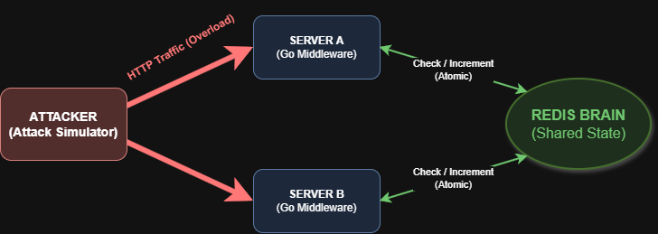
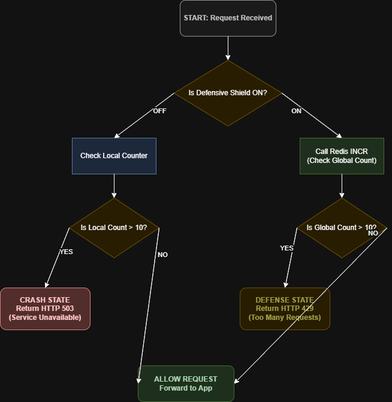

# Distributed Rate Limiter

A production-grade distributed rate limiting system built with **Go**, **Redis**, and **WebSockets**, featuring a real-time cybersecurity "War Room" dashboard that visualizes traffic flow, attack simulation, and system resilience across a multi-node cluster.



---

## Features

- **Cluster-Wide Rate Limiting** — Redis-backed atomic counters enforce a global 10 RPS threshold per IP across all instances.
- **Hardware Failure Simulation** — Toggle the limiter off to simulate unprotected servers crashing under load (503 Service Unavailable).
- **Real-Time War Room Dashboard** — Animated SVG-based visualization showing packet flow between Attacker → Servers → Redis with live counters, particle streams, and crash indicators.
- **WebSocket Event Streaming** — All cluster events (traffic, control, attack, burst) are broadcast in real-time via Redis Pub/Sub → WebSocket.
- **Built-In Attack Generator** — Configurable RPS attack simulation (1–5000 RPS) fired directly from the dashboard UI.
- **Multi-Instance Architecture** — Docker Compose spins up 2 Go server instances + 1 Redis node to demonstrate true distributed behavior.
- **System Event Console** — Scrollable, timestamped log panel showing every request, block, and crash event.

---

## Architecture

The system uses a hub-and-spoke architecture with Redis as the central coordination layer:



```
┌─────────────┐       ┌─────────────┐       ┌─────────────┐
│  Attacker    │──────▶│  App 1       │──────▶│             │
│  (Browser)   │       │  :8081       │       │   Redis     │
│              │──────▶│  App 2       │◀─────▶│   :6379     │
│              │       │  :8082       │       │             │
└─────────────┘       └─────────────┘       └─────────────┘
       │                     ▲
       │    WebSocket        │  Pub/Sub
       └─────────────────────┘
```

**Key Components:**

| Component | Role |
|-----------|------|
| `main.go` | Go HTTP server with rate limiting middleware, WebSocket hub, Redis Pub/Sub subscriber, and attack engine |
| `static/index.html` | War Room dashboard — animated SVG arena, command center controls, system event console |
| `docker-compose.yaml` | Orchestrates 2 app instances + 1 Redis container |
| `Dockerfile` | Multi-stage Go build using `golang:1.22-alpine` |

---

## Prerequisites

- [Docker](https://docs.docker.com/get-docker/) & [Docker Compose](https://docs.docker.com/compose/install/)
- (Optional) [Go 1.21+](https://go.dev/dl/) — only if running outside Docker

---

## Installation & Setup

### 1. Clone the repository

```bash
git clone https://github.com/<your-username>/distributed-limiter.git
cd distributed-limiter
```

### 2. Start the cluster (Docker)

```bash
docker-compose up --build
```

This spins up:
- **Redis** on `localhost:6379`
- **App 1** on `localhost:8081`
- **App 2** on `localhost:8082`

### 3. Open the Dashboard

Navigate to either instance in your browser:

```
http://localhost:8081
```

---

## Usage

### Dashboard Controls

| Control | Description |
|---------|-------------|
| **Global Limiter Shield** (toggle) | Enables/disables the Redis-backed distributed rate limiter across all nodes. When OFF, servers run unprotected and will crash under load. |
| **RPS Input** | Set the requests-per-second for the attack simulation (1–5000). |
| **Start Attack** | Fires a burst of traffic at the configured RPS. The attack runs for ~1.5 seconds, then auto-stops. |

### What to observe

1. **Limiter ON + Attack** → Packets flow from Attacker → Servers → Redis. After 10 RPS, requests get blocked (429). The path shows a red **✖** and the system event log shows `ATTACK DEFLECTED`.

2. **Limiter OFF + Attack** → Servers have no Redis protection. After 10 local requests, servers crash (503). Nodes shake, display a pulsing **✖**, and the log shows `CRITICAL FAILURE`.

### Running without Docker (local development)

```bash
# Terminal 1: Start Redis
redis-server

# Terminal 2: Start App 1
INSTANCE_NAME=app1 REDIS_URL=localhost:6379 go run main.go

# Terminal 3: Start App 2 (on a different port)
INSTANCE_NAME=app2 REDIS_URL=localhost:6379 go run main.go
```

> **Note:** When running locally, both instances share port 8080 by default. You'll need to modify the port for the second instance or use Docker Compose for the full multi-node experience.

---

## API Endpoints

| Endpoint | Method | Description |
|----------|--------|-------------|
| `/` | GET | Serves the War Room dashboard |
| `/api/test` | GET | Rate-limited test endpoint — returns `200`, `429`, or `503` |
| `/ws` | GET | WebSocket connection for real-time event streaming |

---

## Environment Variables

| Variable | Default | Description |
|----------|---------|-------------|
| `INSTANCE_NAME` | `unknown-instance` | Identifier for this server node |
| `REDIS_URL` | `localhost:6379` | Redis connection address |

---

## Tech Stack

| Technology | Purpose |
|------------|---------|
| **Go 1.21** | HTTP server, rate limiting logic, attack engine |
| **Redis** | Distributed counters (INCR + EXPIRE), Pub/Sub for cluster events |
| **WebSockets** (gorilla/websocket) | Real-time dashboard event streaming |
| **HTML/CSS/JS** | War Room dashboard with SVG animations |
| **Docker Compose** | Multi-container orchestration |

---

## License

MIT
